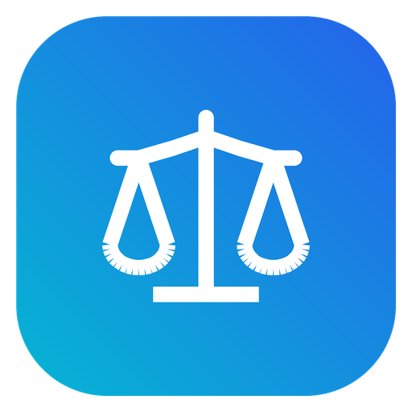

# BPM Court Scanner

### Automated Court Docket & Brief Scraping for Modern Legal Teams

[-blue?style=flat-square&logo=windows)](https://github.com/QWARDZ/BPM-Court-Scanner/releases/latest)

[**Web Portal**](https://qwardz.github.io/BPM-Court-Scanner/) • [**Download .exe**](https://github.com/QWARDZ/BPM-Court-Scanner/releases/latest/download/BPM_Court_Scanner.exe) • [**User Guide**](https://qwardz.github.io/BPM-Court-Scanner/#guide) • [**Releases**](https://github.com/QWARDZ/BPM-Court-Scanner/releases)

---

## ⚖️ Overview

**BPM Court Scanner** is a specialized, production-ready desktop automation suite designed for appellate legal researchers, paralegals, and law firms. It automates the discovery, classification, metadata extraction, and batch downloading of appellate brief PDFs across both New York and Kentucky appellate court dockets.

Operating 100% locally on your machine, it communicates directly with court portals without routing sensitive legal queries through third-party cloud servers.

---

## 🏛️ Supported Jurisdictions

| Jurisdiction | Portal / System | Coverage & Capabilities |
| :--- | :--- | :--- |
| **New York (NY AD2)** | NYSCEF & Handdowns Portal | Automated parsing of daily Motion List calendars, dynamic Edge session handling, Captcha human handoff, and full brief document retrieval. |
| **Kentucky (KY C-Track)** | KYCOA & KYSC (KCOJ) | Instant C-Track docket synchronization, multi-month navigation, automated brief classification (Appellant, Appellee, Reply, Cross-Appeals), and 1-click batch PDF download. |

---

## ✨ Key Features

* **⚡ Auto-Docket Synchronization:** Instantly loads and populates monthly court dockets upon startup or month selection—no manual query configurations required.
* **🎯 Brief Classification Engine:** Automatically tags and filters hits (*Appellant Brief*, *Appellee Brief*, *Reply Brief*, *Combined Briefs*) while filtering out routine procedural filings.
* **🛡️ Captcha-Safe Human Handoff:** When court cloud security or anti-bot challenges appear, the scanner gracefully surfaces the native browser window for human completion and resumes scanning seamlessly.
* **🔒 100% Local Privacy:** Zero cloud data leaks. Court credentials, search queries, and downloaded legal documents stay entirely on your local machine.
* **📊 Audit-Ready Excel Reports:** Automatically exports and updates structured `.xlsx` trackers with standardized Save-As naming conventions, docket filing dates, and case metadata.
* **📦 Single-File Portable Executable:** Packaged as a standalone Windows binary (`BPM_Court_Scanner.exe`) with all dependencies bundled inside—no installers, Python runtime, or setup wizards needed.

---

## 🚀 Quick Start

1. **Download:** Grab the latest standalone executable directly:
   * 📥 [**Download BPM_Court_Scanner.exe**](https://github.com/QWARDZ/BPM-Court-Scanner/releases/latest/download/BPM_Court_Scanner.exe)
2. **Save & Run:** Place `BPM_Court_Scanner.exe` in your desired workspace folder or Desktop.
3. **Double-Click:** Launch the application. 
   * *Note for Windows Defender SmartScreen:* If prompted with *"Windows protected your PC"* on first launch, click **More info** ➔ **Run anyway**.

---

## 👨‍💻 Developer & Attribution

* **Architect & Developer:** John Edward Bearneza
* **Repository:** [https://github.com/QWARDZ/BPM-Court-Scanner](https://github.com/QWARDZ/BPM-Court-Scanner)
* **Documentation Website:** [https://qwardz.github.io/BPM-Court-Scanner/](https://qwardz.github.io/BPM-Court-Scanner/)
* **Copyright:** © 2026 John Edward Bearneza. All rights reserved.

